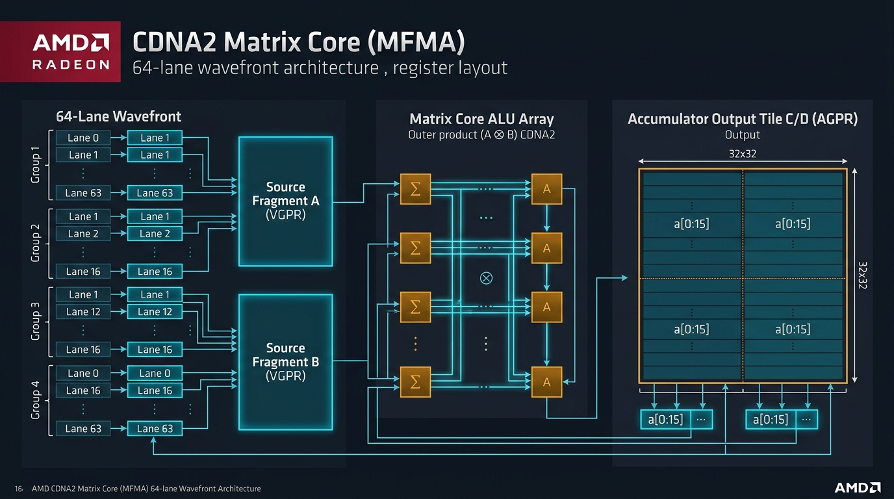
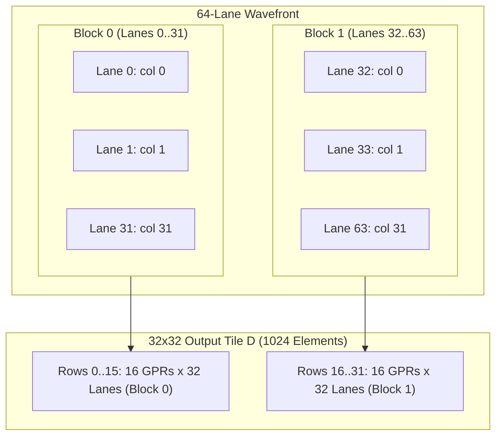

# AMD CDNA2 Matrix Core (MFMA) Lane & Register Layout Guide

The **AMD CDNA2 (MI200 / GFX90a)** architecture introduces second-generation Matrix Cores (**MFMA** — Matrix Fused Multiply-Add) to accelerate dense linear algebra, GEMMs, and deep learning primitives.

Unlike conventional Vector ALUs (VALU) where each lane operates independently in SIMD fashion, **MFMA instructions operate cooperatively across all 64 lanes of a Wavefront**. The 64 lanes collectively hold fragments of input matrices $A$ and $B$, broadcast them across an internal cross-lane systolic interconnect, and accumulate outer products into **Accumulator VGPRs (AGPRs)**.

`gcn-sim` implements bit-accurate functional emulation of all CDNA2 MFMA instructions, cross-lane fragment broadcasting, and cycle-approximate pipeline timing.

---

## 1. Architectural Overview & Wavefront Mapping

<div align="center">



</div>

### Key Architectural Concepts
1. **Wavefront Size = 64 Lanes**:
   All 64 threads (`lane = 0 .. 63`) in the wavefront collaborate to compute a matrix tile.
2. **EXEC Mask Bypass**:
   Per AMD CDNA ISA specifications, **MFMA instructions bypass the 64-bit `EXEC` mask**. Even if a lane is disabled by conditional branching, it participates in matrix outer products to guarantee correct accumulation.
3. **Dedicated Accumulator Storage (AGPRs)**:
   GFX90a provides 256 standard Vector General-Purpose Registers (`v[0:255]`) and 256 Accumulator Registers (`a[0:255]`).
   - GEMM kernels accumulate directly into `a[...]` without occupying standard vector registers.
   - This enables perfect double-buffering: global/LDS memory prefetches load into `v[...]` while the Matrix Cores compute on `a[...]` in parallel.

---

## 2. Instruction Matrix Formats & Lane Layouts

### A. `v_mfma_f32_32x32x1f32` (Single-Precision Outer Product, $K=1$)

Computes a $32 \times 32$ matrix multiply with $K=1$:
$$\mathbf{D}_{32 \times 32} = \mathbf{A}_{32 \times 1} \times \mathbf{B}_{1 \times 32} + \mathbf{C}_{32 \times 32}$$

- **Input Fragments**:
  - `src0` (Matrix $A$): 1 float per lane (32 unique rows across block).
  - `src1` (Matrix $B$): 1 float per lane (32 unique columns across block).
- **Output Storage**:
  - 1024 output elements total ($32 \times 32$).
  - Distributed across **64 lanes $\times$ 16 registers = 1024 elements** (`a[0:15]` or `v[0:15]`).

#### Block & Lane Partitioning
The 64-lane wavefront is split into **2 blocks of 32 lanes**:
- **Block 0 (Lanes 0–31)**: Computes matrix rows $0 \dots 15$.
- **Block 1 (Lanes 32–63)**: Computes matrix rows $16 \dots 31$.



#### Mapping Equations:
For lane $L \in [0, 63]$ and register index $g \in [0, 15]$:
$$\text{block} = \lfloor L / 32 \rfloor \in \{0, 1\}$$
$$\text{col} = L \pmod{32}$$
$$\text{row} = \text{block} \times 16 + g$$
$$\mathbf{D}[\text{row}][\text{col}] \leftarrow \mathbf{a}[g][L]$$

- **Matrix $A$ Broadcast**: $A[\text{row}][0]$ resides in `src0` of Lane $(\text{block} \times 32 + g)$. The Matrix Core broadcasts this scalar to all 32 lanes in the block.
- **Matrix $B$ Vector**: $B[0][\text{col}]$ resides in `src1` of Lane $L$.

---

### B. `v_mfma_f32_32x32x2f32` (Unrolled Step, $K=2$)

Computes a $32 \times 32$ matrix multiply accumulating over $K=2$:
$$\mathbf{D}_{32 \times 32} = \sum_{k=0}^{1} \mathbf{A}_{32 \times 1}^{(k)} \times \mathbf{B}_{1 \times 32}^{(k)} + \mathbf{C}_{32 \times 32}$$

This instruction is the workhorse of AMD Tensile and rocBLAS FP32 GEMMs.

#### K-Group Partitioning
The 64 lanes are partitioned into **two K-groups**:
- **K-group 0 (Lanes 0–31)**: Holds $A[:, 0]$ and $B[0, :]$.
- **K-group 1 (Lanes 32–63)**: Holds $A[:, 1]$ and $B[1, :]$.

```
Lane Index (0..63):
┌───────────────────────────────┬───────────────────────────────┐
│     K-group 0 (Lanes 0..31)   │    K-group 1 (Lanes 32..63)   │
│       Processes K = 0         │        Processes K = 1        │
└───────────────────────────────┴───────────────────────────────┘
```

#### Register & Matrix Coordinate Mapping:
For lane $L$ ($lane\_hi = \lfloor L / 32 \rfloor$, $col = L \pmod{32}$) and GPR $g \in [0, 15]$:
$$\text{row} = 8 \times \lfloor g / 4 \rfloor + 4 \times lane\_hi + (g \pmod 4)$$

```
GPR Mapping Matrix (Row Index vs GPR g and Lane Group):
┌───────────┬───────────────┬───────────────┐
│ GPR Index │ Lane 0..31    │ Lane 32..63   │
│           │ (lane_hi = 0) │ (lane_hi = 1) │
├───────────┼───────────────┼───────────────┤
│ g = 0..3  │ Rows 0..3     │ Rows 4..7     │
│ g = 4..7  │ Rows 8..11    │ Rows 12..15   │
│ g = 8..11 │ Rows 16..19   │ Rows 20..23   │
│ g = 12..15│ Rows 24..27   │ Rows 28..31   │
└───────────┴───────────────┴───────────────┘
```

- Each lane computes all 16 rows assigned to its column across both $K=0$ and $K=1$ in a single hardware cycle burst.

---

### C. `v_mfma_f32_16x16x4f32` (Compact Tile, $K=4$)

Computes a $16 \times 16$ matrix multiply accumulating over $K=4$:
$$\mathbf{D}_{16 \times 16} = \sum_{k=0}^{3} \mathbf{A}_{16 \times 1}^{(k)} \times \mathbf{B}_{1 \times 16}^{(k)} + \mathbf{C}_{16 \times 16}$$

- **Tile Size**: $16 \times 16 = 256$ elements.
- **Output Storage**: 64 lanes $\times$ 4 registers (`a[0:3]`) = 256 elements.
- **Four K-groups of 16 lanes**:
  - $kg = \lfloor L / 16 \rfloor \in \{0, 1, 2, 3\}$.
  - Lane $L$ contributes to:
    $$\text{col} = L \pmod{16}$$
    $$\text{row} = \lfloor L / 16 \rfloor \times 4 + g \quad (g \in [0, 3])$$

---

## 3. Supported MFMA Instruction Summary

| Opcode | Input Types | Output Type | Tile Size ($M \times N \times K$) | Output GPRs / Lane | Total Elements |
| :--- | :---: | :---: | :---: | :---: | :---: |
| `v_mfma_f32_32x32x1f32` | FP32 $\times$ FP32 | FP32 | $32 \times 32 \times 1$ | 16 (`a[0:15]`) | 1024 |
| `v_mfma_f32_32x32x2f32` | FP32 $\times$ FP32 | FP32 | $32 \times 32 \times 2$ | 16 (`a[0:15]`) | 1024 |
| `v_mfma_f32_16x16x1f32` | FP32 $\times$ FP32 | FP32 | $16 \times 16 \times 1$ | 16 (`a[0:15]`) | 256 (x4 blocks) |
| `v_mfma_f32_16x16x4f32` | FP32 $\times$ FP32 | FP32 | $16 \times 16 \times 4$ | 4 (`a[0:3]`) | 256 |
| `v_mfma_f32_4x4x1f32` | FP32 $\times$ FP32 | FP32 | $4 \times 4 \times 1$ | 4 (`a[0:3]`) | 16 (x16 blocks) |
| `v_mfma_f32_32x32x4f16` | FP16 $\times$ FP16 | FP32 | $32 \times 32 \times 4$ | 16 (`a[0:15]`) | 1024 |
| `v_mfma_f32_16x16x4f16` | FP16 $\times$ FP16 | FP32 | $16 \times 16 \times 4$ | 4 (`a[0:3]`) | 256 |
| `v_mfma_i32_32x32x4i8` | INT8 $\times$ INT8 | INT32 | $32 \times 32 \times 4$ | 16 (`a[0:15]`) | 1024 |
| `v_mfma_i32_16x16x4i8` | INT8 $\times$ INT8 | INT32 | $16 \times 16 \times 4$ | 4 (`a[0:3]`) | 256 |
| `v_mfma_f64_16x16x4f64` | FP64 $\times$ FP64 | FP64 | $16 \times 16 \times 4$ | 8 (`a[0:7]` pairs) | 256 |

---

## 4. How `gcn-sim` Simulates Matrix Cores

In `src/isa_executor.cpp`:
1. **Cross-Lane Collection**:
   Before updating any lane state, `read_vsrc()` extracts all 64 source values into CPU arrays (`a_all[64]` and `b_all[64]`). This mirrors the hardware's internal register read stage.
2. **Hardware Outer-Product Emulation**:
   For each lane, the exact row and column formulas map incoming matrix elements into standard IEEE-754 `fmaf(a, b, c)` or double-precision `fma()`.
3. **Execution Shadow & Pipeline Interaction**:
   `src/cycle_model.cpp` tracks the 64-cycle MFMA duration and enables up to 15 parallel VALU instructions in the shadow window without extra latency overhead.
