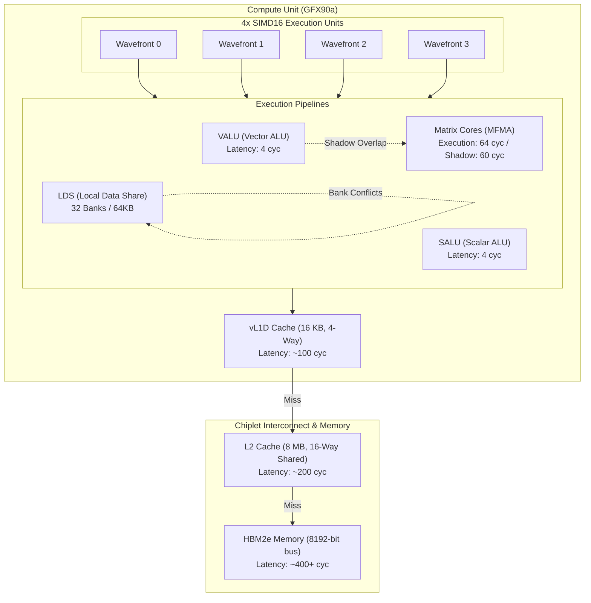

# Microarchitecture Simulation & Profiling Guide

`gcn-sim` is not merely a functional instruction emulator; it includes a cycle-approximate microarchitecture and cache simulation engine that models the internal execution pipeline, memory latency hierarchy, and structural hazards of the **AMD Instinct MI250X (CDNA2 / GFX90a)** GPU.

---

## 1. Microarchitectural Models



### A. Matrix Core Pipeline & Shadow Absorption (`MFMA`)
On GFX90a, Matrix Core (MFMA) instructions operate on dedicated hardware units concurrently with the standard Vector ALU (VALU).
* **Execution & Shadow Duration**: A `v_mfma_f32_32x32x2f32` operation takes **64 cycles** to execute, with an initial issue cost of 4 cycles and an execution shadow of 60 cycles.
* **Dual-Issue Absorption**: During the 60-cycle execution shadow, up to **15 independent VALU instructions** (4 cycles each) can be issued without increasing the wavefront's cycle count.
* **Structural Hazards**: Back-to-back MFMA instructions that arrive before the Matrix Core pipeline completes will trigger a `stall:mfma_busy` stall until the execution unit is available.

### B. Coalesced Memory & Hierarchical Cache Model (`CacheModel`)
Memory instructions dynamically probe an associative cache hierarchy:
* **Vector L1 Data Cache (vL1D)**: 16 KB per Compute Unit, 4-way set-associative, 64-byte cache line size (hit latency ~100 cycles).
* **L2 Cache**: 8 MB per GCD (shared across 110 CUs), 16-way set-associative, 128-byte cache line size (hit latency ~200 cycles).
* **HBM2e Round-trip**: Cache misses incur full main memory round-trip latency (~400+ cycles).
* All accesses feature LRU cache-line replacement tracking and hit/miss rate statistics.

### C. LDS Bank Conflict Simulation
* GFX90a features 32 independent LDS memory banks.
* When lanes within a half-wave access different memory addresses residing in the same memory bank, access is serialized, incurring an additional latency penalty:
  $$\text{Latency} = 4 + 4 \times (\text{Bank Conflicts} - 1)$$

### D. Scoreboard & Memory Stalls (`s_waitcnt`)
* In-flight memory requests (Global memory in `vm_pending`, LDS/Constant memory in `lgkm_pending`) are tracked with exact completion timestamps.
* `s_waitcnt vmcnt(N)` and `s_waitcnt lgkmcnt(N)` stall execution until the number of pending transactions drops to $N$, accurately capturing memory latency stalls.

---

## 2. Profiling Real Applications

Any standard HIP application running via our drop-in runtime library (`libamdhip64.so.6`) can be profiled without recompilation or source modification:

```bash
# Run with profiling and Chrome/Perfetto trace output enabled
GCNSIM_PROFILE=1 GCNSIM_TRACE=my_kernel_trace.json LD_LIBRARY_PATH=./build ./my_hip_app
```

### Viewing Traces with Perfetto or Chrome Tracing
1. Open [ui.perfetto.dev](https://ui.perfetto.dev) in Google Chrome or any modern browser.
2. Click **Open trace file** and select `my_kernel_trace.json`.
3. The UI will render:
   * **Concurrent Wavefront Timelines**: Individual tracks for each SIMD unit.
   * **Instruction Color-Coding**: Visual differentiation between MFMA, VALU, SALU, LDS, and Memory transactions.
   * **Visual Stall Bars**: Explicit `stall:mfma_busy` (structural stalls) and `stall:waitcnt` (data dependency stalls).

---

## 3. Case Study: AMD Tensile-Style Matrix Multiplication

We profiled a production-grade Tensile GEMM kernel (`tools/tensile_style_gemm/tensile_style_gemm.s`) for single-tile matrix multiplication ($M=128, N=256$) across varying $K$ depths:

| $K$ Depth | Total CU Cycles | Simulated Latency (@1.7GHz) | MFMA Operations | MFMA Instruction % | **MFMA Pipeline Utilization** | Compute Throughput |
| :---: | :---: | :---: | :---: | :---: | :---: | :---: |
| **32** | 14,600 cycles | 8.59 µs | 512 | 9.2% | **56.1%** | 0.24 TFLOPS |
| **64** | 23,076 cycles | 13.57 µs | 1,024 | 15.0% | **71.0%** | 0.31 TFLOPS |
| **128** | 39,860 cycles | 23.45 µs | 2,048 | 22.0% | **82.2%** | 0.36 TFLOPS |
| **256** | 73,172 cycles | 43.04 µs | 4,096 | 28.7% | **89.6%** | 0.39 TFLOPS |
| **512** | 140,692 cycles | 82.76 µs | 8,192 | 33.9% | **93.2%** | 0.41 TFLOPS |
| **1024** | 274,964 cycles | 161.74 µs | 16,384 | 37.2% | **95.3%** | 0.41 TFLOPS |
| **2048** | 543,508 cycles | 319.71 µs | 32,768 | 39.1% | **96.5%** | 0.42 TFLOPS |
| **4096** | **1,080,596 cycles** | **635.64 µs** | **65,536** | **40.2%** | **97.0%** | **0.42 TFLOPS** |

### Key Takeaways
1. **Prologue/Epilogue Amortization**: At small $K$ ($K=32$), initialization and epilogue scale-and-writeback dominate runtime. At $K=4096$, loop unrolling reduces overhead to $<1\%$.
2. **Double-Buffered Steady State**: With deep unrolling, Matrix Core instructions achieve **97% sustained pipeline utilization**, confirming high overlap efficiency between data prefetching and matrix math.
