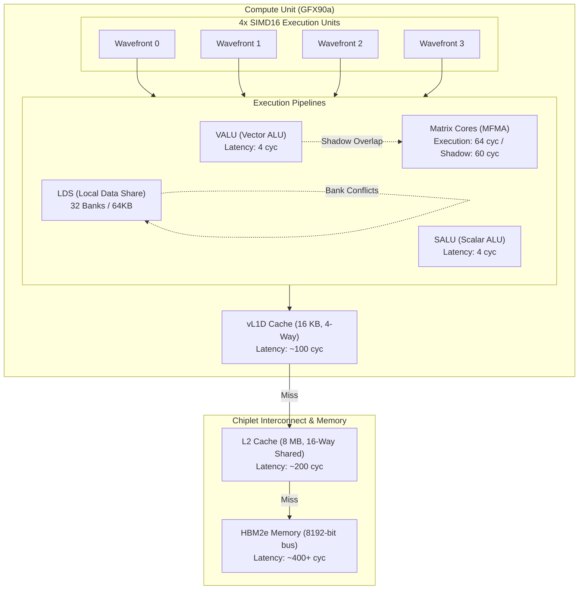
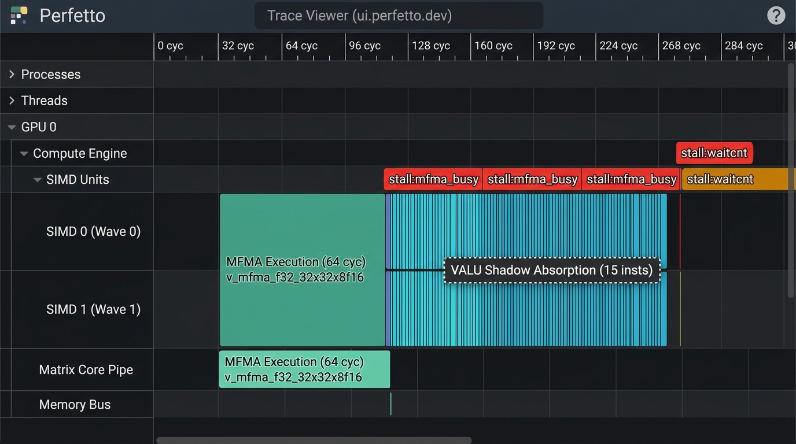

# Microarchitecture Simulation & Profiling Guide

`gcn-sim` is not merely a functional instruction emulator; it includes a cycle-approximate microarchitecture and cache simulation engine modeling internal execution pipelines, multi-level cache hierarchies, structural hazards, and DVFS clock scaling across **AMD Instinct MI100 (`gfx908`), MI210/MI250X (`gfx90a`), MI300X (`gfx942`), MI350X (`gfx950`), and Radeon RX 9070 XT (`gfx1201`)**. The pipeline walkthrough below uses MI250X (`gfx90a`) as the baseline reference.

---

## 1. Microarchitectural Models



### A. Matrix Core Pipeline & Shadow Absorption (`MFMA`)
On GFX90a, Matrix Core (MFMA) instructions operate on dedicated hardware units concurrently with the standard Vector ALU (VALU).
* **Execution & Shadow Duration**: A `v_mfma_f32_32x32x2f32` operation takes **64 cycles** to execute, with an initial issue cost of 4 cycles and an execution shadow of 60 cycles.
* **Dual-Issue Absorption**: During the 60-cycle execution shadow, up to **15 independent VALU instructions** (4 cycles each) can be issued without increasing the wavefront's cycle count.
* **Structural Hazards**: Back-to-back MFMA instructions that arrive before the Matrix Core pipeline completes will trigger a `stall:mfma_busy` stall until the execution unit is available.

```
Cycle Timeline (Dual-Issue Shadow Execution):
Cycle:  0       4               20              36              52       64
        ├───────┼───────────────┼───────────────┼───────────────┼────────┤
MFMA:   │ Issue │ ◄────────────── MFMA Matrix Execution (60 cyc) ───────►│ Done
VALU:   │ Wait  │ VALU 1 │ VALU 2 │ VALU 3 │ ... │ VALU 15 (Shadowed)   │
        └───────┴────────┴────────┴────────┴─────┴──────────────────────┘
        ▲                                                               ▲
        │ 0 Added Delay (VALU execution is completely absorbed!)        │
```

> [!NOTE]
> For the complete breakdown of 64-lane wavefront data distributions, input fragments, and output AGPR tiles, see the [MFMA Lane & Register Layout Guide](mfma_lane_layout.md).

### B. Coalesced Memory & Hierarchical Cache Model (`CacheModel`)
Memory instructions dynamically probe an associative cache hierarchy:
* **Vector L1 Data Cache (vL1D)**: 16 KB per Compute Unit, 4-way set-associative, 64-byte cache line size (hit latency ~100 cycles).
* **L2 Cache**: 8 MB per GCD (shared across 110 CUs), 16-way set-associative, 128-byte cache line size (hit latency ~200 cycles).
* **HBM2e Round-trip**: Cache misses incur full main memory round-trip latency (~400+ cycles).
* All accesses feature LRU cache-line replacement tracking and hit/miss rate statistics.

### C. LDS Bank Conflict Simulation
* GFX90a features 32 independent LDS memory banks.
* When lanes within a half-wave access different memory addresses residing in the same memory bank, access is serialized, incurring an additional latency penalty:
  $$\text{Latency} = 4 + 4 \times (\text{Bank Conflicts} - 1)$$

### D. Scoreboard & Memory Stalls (`s_waitcnt` / `s_wait_*`)
* In-flight memory requests (Global memory in `vm_pending`, LDS/Constant memory in `lgkm_pending`, plus RDNA4 GFX12 split `store_pending`, `ds_pending`, `km_pending`) are tracked with exact completion timestamps.
* `s_waitcnt vmcnt(N)` / `lgkmcnt(N)` (and GFX12 `s_wait_*`) stall execution until the number of pending transactions drops to $N$, accurately capturing memory latency stalls.

### E. Multi-Architecture Cache & Compute Topology

`src/execution_engine.cpp` and `src/hijack/hip_hijack.cpp` parameterize CU/WGP counts, cache sizes, LDS limits, and clock domains per target architecture (`GCN_SIM_ARCH`):

| Target GPU (`GCN_SIM_ARCH`) | Engine CUs / WGPs | Wave Size | LDS / Block | vL1D Cache | Shared L2 Cache | L3 Infinity Cache | Boost / Base SCLK |
| :--- | :---: | :---: | :---: | :---: | :---: | :---: | :---: |
| **MI100 (`gfx908`)** | 120 CUs | 64 | 64 KB | 16 KB (4-way) | 8 MB (16-way) | — | 1.502 / 1.087 GHz |
| **MI250X / MI210 (`gfx90a`)** | 104 CUs (engine) | 64 | 64 KB | 16 KB (4-way) | 8 MB (16-way) | — | 1.70 / 1.30 GHz (MI210 Base 1.20) |
| **MI300X (`gfx942`)** | 304 CUs (8 XCDs) | 64 | 64 KB | 32 KB (4-way) | 32 MB | 256 MB (180 cyc) | 2.10 / 1.70 GHz |
| **MI350X (`gfx950`)** | 256 CUs (8 XCDs) | 64 | 160 KB | 32 KB (4-way) | 32 MB | 256 MB (180 cyc) | 2.10 / 1.65 GHz |
| **RX 9070 XT (`gfx1201`)** | 32 WGPs (64 CUs) | 32 | 64 KB (128 KB/WGP) | 32 KB / WGP | 8 MB | 64 MB (160 cyc) | 2.97 / 2.40 GHz |

---

## 2. Profiling Real Applications

Cycle counting is enabled automatically in `libamdhip64.so`. Any standard HIP or PyTorch application running via `libamdhip64.so` can export Perfetto/Chrome timeline traces without recompilation or source modification:

```bash
# Run with Chrome/Perfetto trace output enabled
GCNSIM_TRACE=my_kernel_trace.json LD_LIBRARY_PATH=./build ./my_hip_app
```

### Clock Scaling & Dynamic DVFS Modeling

`src/hijack/hip_hijack.cpp` converts simulated CU cycles to kernel execution time (`hipEventElapsedTime`) using the selected architecture's clock model:
- **Fixed Frequency Override**: `GCN_SIM_CLOCK_MHZ=<MHz>` (or `GCN_SIM_SCLK=<MHz>`) / `GCN_SIM_CLOCK_KHZ=<kHz>` pins the simulated clock.
- **Scaling Factor**: `GCN_SIM_CLOCK_FACTOR=<f>` (or `GCN_SIM_CLOCK_SCALE=<f>`, clamped to `[0.1, 2.0]`) scales the target's boost clock.
- **Dynamic DVFS Throttling**: Setting `GCN_SIM_DVFS=1` (or `GCN_SIM_POWER_MODEL=1`) interpolates each kernel's clock frequency between Boost and Base SCLK proportionally to its measured `compute_intensity` (MFMA + VALU utilization).

### Viewing Traces with Perfetto or Chrome Tracing
1. Open [ui.perfetto.dev](https://ui.perfetto.dev) in Google Chrome or any modern browser.
2. Click **Open trace file** and select `my_kernel_trace.json`.
3. The UI will render interactive tracks with explicit execution and hazard bars:

<div align="center">



</div>

### Trace Visualization Breakdown
- **SIMD Unit Tracks (SIMD 0–3)**: Separate horizontal rows showing the execution state of active wavefronts over time.
- **Instruction Color Coding**:
  - 🟩 **MFMA Instructions**: Depicted as sustained execution bars (64 cycles).
  - 🟦 **VALU / SALU**: Arithmetic and logic instructions, displaying shadow-absorbed parallel execution.
  - 🟨 **LDS / Memory Transfers**: Shared and global data transactions.
- **Microarchitectural Stall Flags**:
  - 🟥 **`stall:mfma_busy`**: Visualized when an MFMA instruction arrives while the Matrix Core hardware is still computing a previous operation.
  - 🟧 **`stall:waitcnt`**: Highlights cycles where wavefront execution is suspended waiting for pending memory transactions (Global `vmcnt` or LDS `lgkmcnt`) to finish.

---

## 3. Case Study: AMD Tensile-Style Matrix Multiplication

We profiled a production-grade Tensile GEMM kernel (`tools/tensile_style_gemm/tensile_style_gemm.s`) for single-tile matrix multiplication ($M=128, N=256$) across varying $K$ depths:

| $K$ Depth | Total CU Cycles | Simulated Latency (@1.7GHz) | MFMA Operations | MFMA Instruction % | **MFMA Pipeline Utilization** | Compute Throughput |
| :---: | :---: | :---: | :---: | :---: | :---: | :---: |
| **32** | 14,600 cycles | 8.59 µs | 512 | 9.2% | **56.1%** | 0.24 TFLOPS |
| **64** | 23,076 cycles | 13.57 µs | 1,024 | 15.0% | **71.0%** | 0.31 TFLOPS |
| **128** | 39,860 cycles | 23.45 µs | 2,048 | 22.0% | **82.2%** | 0.36 TFLOPS |
| **256** | 73,172 cycles | 43.04 µs | 4,096 | 28.7% | **89.6%** | 0.39 TFLOPS |
| **512** | 140,692 cycles | 82.76 µs | 8,192 | 33.9% | **93.2%** | 0.41 TFLOPS |
| **1024** | 274,964 cycles | 161.74 µs | 16,384 | 37.2% | **95.3%** | 0.41 TFLOPS |
| **2048** | 543,508 cycles | 319.71 µs | 32,768 | 39.1% | **96.5%** | 0.42 TFLOPS |
| **4096** | **1,080,596 cycles** | **635.64 µs** | **65,536** | **40.2%** | **97.0%** | **0.42 TFLOPS** |

### Key Takeaways
1. **Prologue/Epilogue Amortization**: At small $K$ ($K=32$), initialization and epilogue scale-and-writeback dominate runtime. At $K=4096$, loop unrolling reduces overhead to $<1\%$.
2. **Double-Buffered Steady State**: With deep unrolling, Matrix Core instructions achieve **97% sustained pipeline utilization**, confirming high overlap efficiency between data prefetching and matrix math.
